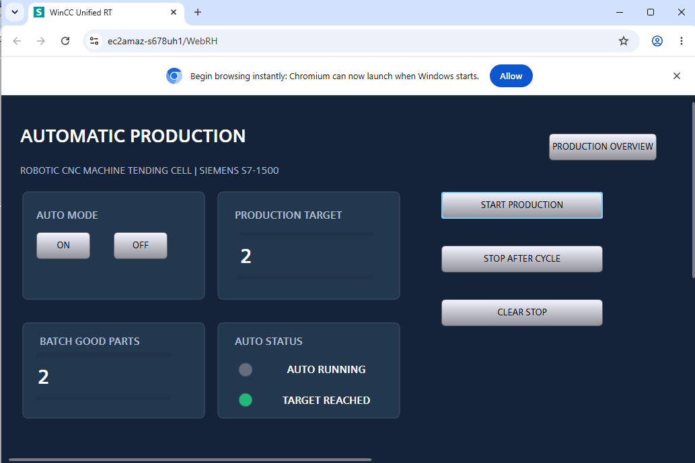
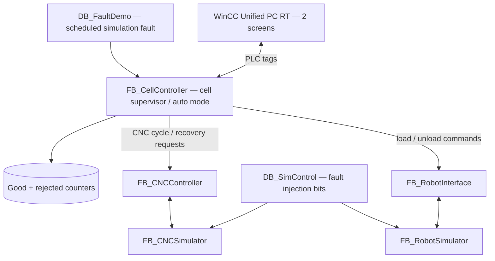

# Robotic CNC Machine Tending Cell — Siemens S7-1500

**Development version:** v1.1 (12 November 2026) — simulation testing documented; **release candidate, not yet independently rebuilt from the final TIA archive**.  
**Published stable baseline:** [v1.0.0](https://github.com/Prathap20/siemens-s7-1500-robotic-cnc-cell/releases/tag/v1.0.0)  
**Tools:** TIA Portal V21 · CPU 1516-3 PN/DP · SCL · PLCSIM Advanced V8 Update 1 · WinCC Unified PC Runtime

> **Simulation-only engineering portfolio.** Robot and CNC are simulated FBs; no physical equipment, safety-rated clearance, emergency-stop system, or certified cell has been demonstrated. `RobotClear` is a manual **simulation** permissive.

## What's new in v1.1

Version 1.1 extends the single-cycle cell supervisor with:

- **Automatic repeat:** START once to produce multiple parts without repeated operator start commands.
- **Target-based stopping:** `TargetGoodParts`, `BatchGoodParts`, and `TargetReached`.
- **Stop After Cycle:** completes the current part before preventing the next cycle.
- **Deterministic fault scenario:** schedule simulated CNC machining fault **106** on attempt 3.
- **Controlled fault response:** automatic repetition stops on cell error **402**; operator reset invokes existing CNC scrap recovery; rejects counted separately from good parts.
- **Explicit batch resumption:** after successful recovery, another START completes the interrupted original batch target.
- **Two-screen WinCC Unified HMI:** Production Overview and Automatic Production, with live batch counters and status indication.

### Demonstration — automatic production

At a target of **2**, the HMI displayed an active Auto Running signal during production, then **2 Batch Good Parts**, green Target Reached, and inactive Auto Running afterward.

### Demonstration — fault → recovery → resume

| Stage | Screenshot evidence | Observed |
|---|---|---|
| Normal automatic batch | [TC-AUTO-01](assets/v1.1/TC_AUTO_01_ThreePartTarget.png) | 3 good parts, target reached, 0 error |
| Stop After Cycle | [TC-AUTO-02](assets/v1.1/TC_AUTO_02_StopAfterCycle_PLC.png) | stopped before a target of 10 |
| Fault on attempt 3 | [TC-AUTO-03](assets/v1.1/TC_AUTO_03_MachiningFault106.png) | 2 good parts, CNC 106, cell 402, state 900; fault injection bits cleared |
| Scrap recovery | [TC-AUTO-04](assets/v1.1/TC_AUTO_04_ScrapRecovery.png) | rejected count +1, good count unchanged, cell Ready |
| Operator-initiated resume | [TC-AUTO-05](assets/v1.1/TC_AUTO_05_ResumeBatch.png) | 3 good parts, 1 rejected, target reached; cell Ready |
| HMI compilation | [Compile evidence](assets/v1.1/HMI_02_Compile_ZeroErrors.png) | 16 tags, 2 screens, 0 errors and 0 warnings |
| HMI stop request | [PLC observation](assets/v1.1/HMI_02_StopRequest_PLC.png) and [Runtime stopped state](assets/v1.1/HMI_02_StopAfterCycle_Result.png) | StopAfterCycle TRUE while running; subsequently Auto Running inactive below target |

More details and limitations: [v1.1 validation matrix](docs/V1_1_VALIDATION.md).

## System design

**Main OB1 execution order:** Cell Controller → Robot Interface → Robot Simulator → CNC Controller → CNC Simulator. See the [original v1.0 OB1 wiring screenshot](assets/Robotic_CNC_Cell_OB1_All_Networks.png). No change to this execution order has been reported for v1.1.

## Source-code provenance — please read before using

- `plc/baseline_v1.0/` contains the **authoritative exported v1.0 combined SCL source** (five FBs, 12 DBs, four UDTs). It is **not** v1.1.
- `plc/v1.1_reference/` contains the **prepared v1.1 implementation bodies, fault-demo diff and DB declaration** used as the development reference. These files are *not* an independently verified, complete export of the final deployed v1.1 TIA project.
- The **authoritative final v1.1 exported SCL and final `.zap21`** have **not been supplied in this chat**. Add the new source into `plc/exported/` after exporting it from the actual saved TIA v1.1 project; don't relabel the v1.0 export as v1.1.
- Graphical Main [OB1] and a supplementary FC are not represented in the combined v1.0 SCL export; the Siemens engineering archive is necessary for an exact restore.

See [source release checklist](docs/V1_1_SOURCE_AND_RELEASE.md) and [v1.1 testing details](docs/V1_1_VALIDATION.md).

## Repository layout

| Location | Description |
|---|---|
| `assets/` | v1.0 baseline screenshots and `assets/v1.1/` test screenshots |
| `plc/baseline_v1.0/` | Original v1.0 complete combined SCL export |
| `plc/v1.1_reference/` | v1.1 development reference code, not a full exported project |
| `plc/exported/` | Place the final v1.1 TIA source export here once exported |
| `docs/` | Architecture, test matrix, release/readiness and reproducibility notes |
| `tia-archive/` | Guidance on original `.zap21` archiving and privacy review |

## Current scope and limitations

Normal auto-batch execution, scheduled machining fault 106, operator-initiated scrap recovery and explicit restart have been demonstrated through simulated PLC watch-table tests. HMI Auto Running, batch counter and Target Reached readback have been demonstrated live. A HMI STOP command produced a TRUE PLC StopAfterCycle signal; subsequent Runtime showed a stopped state below target.

**Not yet independently demonstrated in evidence here:** final v1.1 restore/recompile from archived project, authoritative combined v1.1 SCL export, unambiguous HMI START button command event separate from watch-table start, a dedicated final PLC stopped-state capture for the HMI stop test, and all industrial interlocks/user permissions. Do not present these as verified.

Future work: automatic robot-clear modeling, operator permission interlocks, robot/CNC diagnostics screens, alarm history, trends and SCADA analytics.

This is an educational simulation. Siemens trademarks identify the tooling used; no Siemens endorsement is implied.
