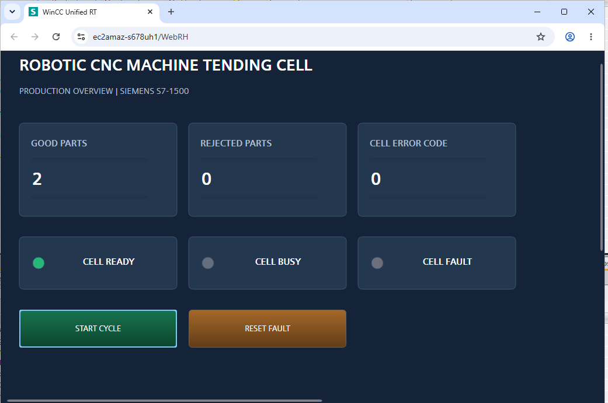
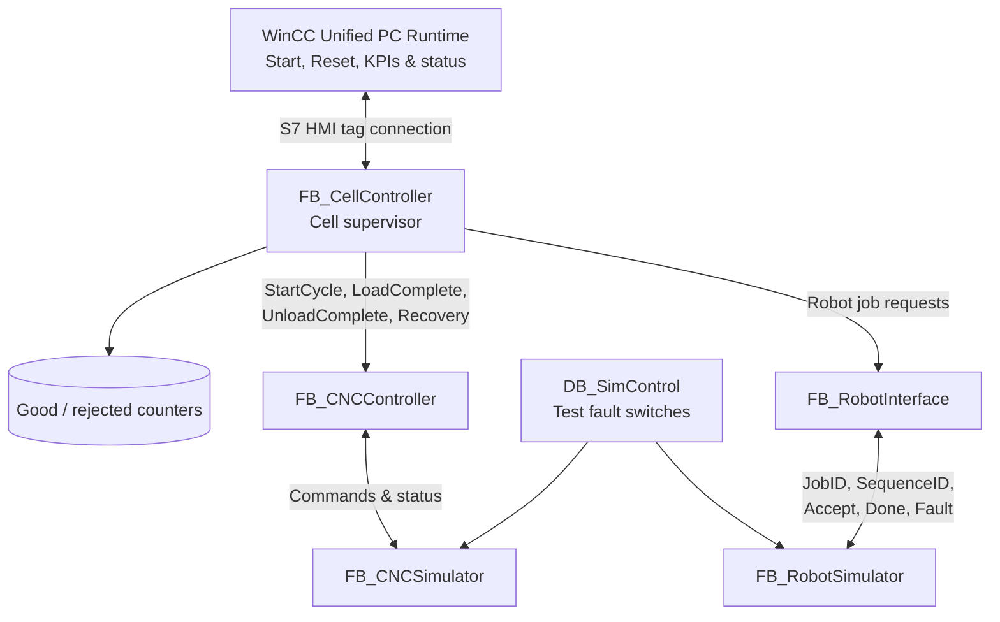

# Robotic CNC Machine Tending Cell — S7-1500, SCL & WinCC Unified

**Version:** v1.0 — verified PLC simulation and live HMI operation (11 November 2026)  
**Platform:** Siemens TIA Portal V21 · SIMATIC S7-1500 CPU 1516-3 PN/DP · S7-PLCSIM Advanced V8 Upd1 · WinCC Unified PC Runtime

> **Simulation-only engineering portfolio.** No physical CNC machine or robot has been controlled. Modeled checks and simulated interlocks are not safety-rated. This project is not production-ready machinery software.

## Demonstration

The virtual CNC cell coordinates a simulated robot and CNC machine through PLC state machines, sequenced robot job handshakes, machine interlocks and fault recovery. An operator uses a browser-based WinCC Unified HMI to start one production cycle and view live machine state, completed parts, rejected parts and error codes.

| Test observation | Verified result |
|---|---|
| WinCC Unified HMI compile | 0 errors, 0 warnings |
| HMI Start command | Cell visibly entered BUSY |
| First successful HMI-started cycle | Good Parts: 0 → 1 |
| Second successful HMI-started cycle | Good Parts: 1 → 2 |
| After second cycle | READY active; BUSY inactive; FAULT inactive; Error Code 0 |
| Earlier machining failure with fault injection | Scrap-recovery path validated: rejected part counted, no good-part count increment |

**Evidence:** [busy](assets/hmi_01_busy.png) · [first good part](assets/hmi_02_first_good_part.png) · [second good part](assets/hmi_03_second_good_part.png) · [PLC ready watch table](assets/plc_watch_table_ready.png). See [validation matrix](docs/VALIDATION_MATRIX.md) for precise scope.

## System architecture

Main supervisory production sequence:

1. Supervisor starts a CNC cycle; CNC controller opens the virtual door.
2. Robot interface executes **Job 10 — LOAD_CNC**; the CNC confirms workpiece loaded.
3. CNC clamps the chuck, closes the door and executes a timed machining cycle.
4. CNC reopens the door and unclamps the workpiece; robot executes **Job 20 — UNLOAD_CNC**.
5. After confirmations, the supervisor increments the Good Parts counter and returns to Ready.

The robot simulator also supports **Job 30 — MOVE_HOME**. The robot/CNC controller interfaces exchange status through global data blocks and are called in OB1. Refer to [architecture](docs/ARCHITECTURE.md) for signal ownership details and the [five-network OB1 screenshot](assets/Robotic_CNC_Cell_OB1_All_Networks.png) for call order and wiring.

## Engineering capabilities

- **SCL PLC control:** deterministic state machines, timers, output signals and completion handshakes.
- **Robot communication:** request/accept/busy/done/ack protocol with job and sequence identifiers; timeout and fault detection.
- **CNC process simulation:** virtual door, chuck, part-present signal, timed machining and permissives.
- **Fault handling:** robot accept/execution faults, machining fault injection (CNC code 106), timeout supervision, conditional recovery and scrap accounting.
- **HMI:** live production counters, status indicators, error code, Start and Reset buttons, S7 data binding.

## Important limitations in v1.0

- **One cycle per Start:** after completion the cell returns to Ready; continuous repeat is planned for v1.1.
- **RobotClear is a manual simulation permissive** set to TRUE in the PLC watch table for tests; it has not been replaced with validated clearance logic.
- **HMI Reset action:** configured but not yet verified end-to-end in a live HMI fault-recovery test.
- **Fault handling:** prior watch-table fault scenarios are tested, but a combined automated multi-cycle fault campaign is not yet implemented.
- **Not a real robot, CNC controller or safety PLC:** physical motion, emergency stops, functional safety and safe robot zone monitoring are outside scope.
- **TIA Portal archive:** the author supplied `Robotic_CNC_Cell_HMI_Implementation.zap21` and its ZIP integrity check passed (see [archive audit](docs/ARCHIVE_AUDIT.md)). The binary project is intentionally **not** included in this public repository ZIP pending privacy, licensing, and restore review. The combined SCL source export is included under `plc/exported/` (five FBs, twelve DBs and four UDTs). The graphical OB1 and an additional FC are not in that export; the unreviewed project archive is held separately. Historical pasted code snapshots remain reference only.

## Files

| Path | Purpose |
|---|---|
| `assets/` | Unmodified screenshots documenting HMI and PLC behavior |
| `docs/ARCHITECTURE.md` | Architecture and ownership of PLC signals |
| `docs/VALIDATION_MATRIX.md` | Validated evidence and remaining test cases |
| `docs/REPRODUCE.md` | How to restore and test in TIA Portal |
| `docs/ROADMAP.md` | v1.1 automatic mode/fault scenarios; v2.0 SCADA |
| `plc/reference_snapshots/` | Historical controller-body snapshots; not authoritative importable exports |
| `plc/exported/` | Combined TIA SCL source export containing five FBs, twelve DBs and four UDTs |
| `tia-archive/` | Archive handling guidance; the original binary is held separately pending review |

## Start / restore

See [docs/REPRODUCE.md](docs/REPRODUCE.md) for TIA Portal V21, PLCSIM Advanced and HMI startup steps. The full project archive exists separately and passed structural checks, but it has not been restored/recompiled independently. The combined source export and screenshots do not fully substitute for the Siemens engineering archive.

## Next releases

- **v1.1:** Auto/Manual, production target, Stop After Cycle, deterministic scenario-driven fault injection, bounded recovery/retries, verified workpiece accounting and controlled restart.
- **v2.0:** Robot/CNC diagnostics screens, alarms/history, HMI operator roles, production trends and SCADA analytics.

This is an independent educational portfolio. Siemens names and trademarks identify the tools used; no Siemens endorsement is implied. No license for third-party reuse is granted unless a license is added explicitly.

## Release integrity and privacy

The supplied TIA Portal project is a separate binary deliverable, not bundled into this public GitHub package. See [Archive audit](docs/ARCHIVE_AUDIT.md) for what can and cannot be verified outside Siemens software. Review user configuration, cloud hostnames, any saved credentials, licensing and bundled backups before sharing the raw archive publicly.
